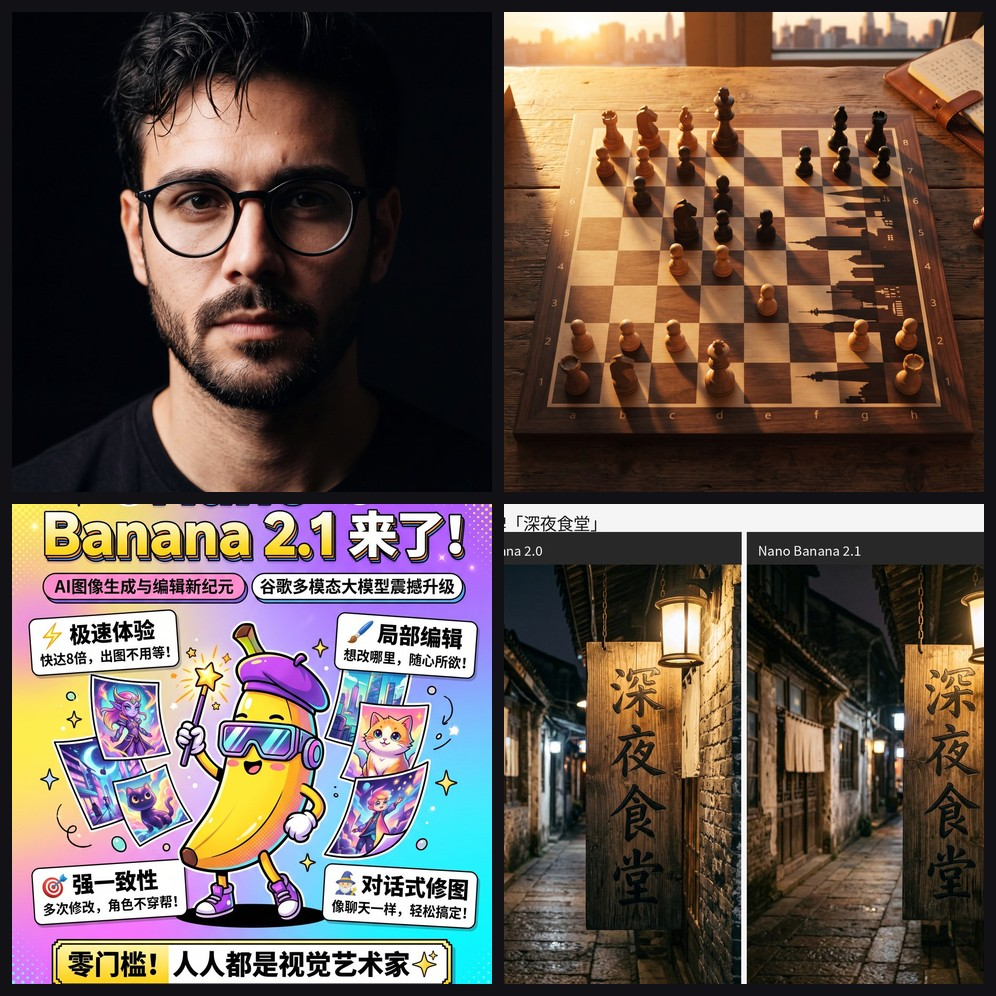
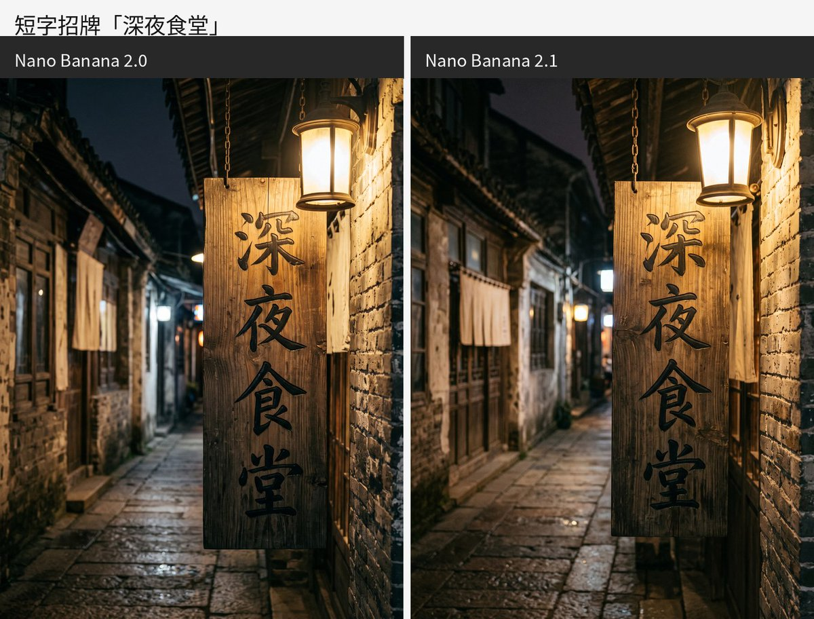
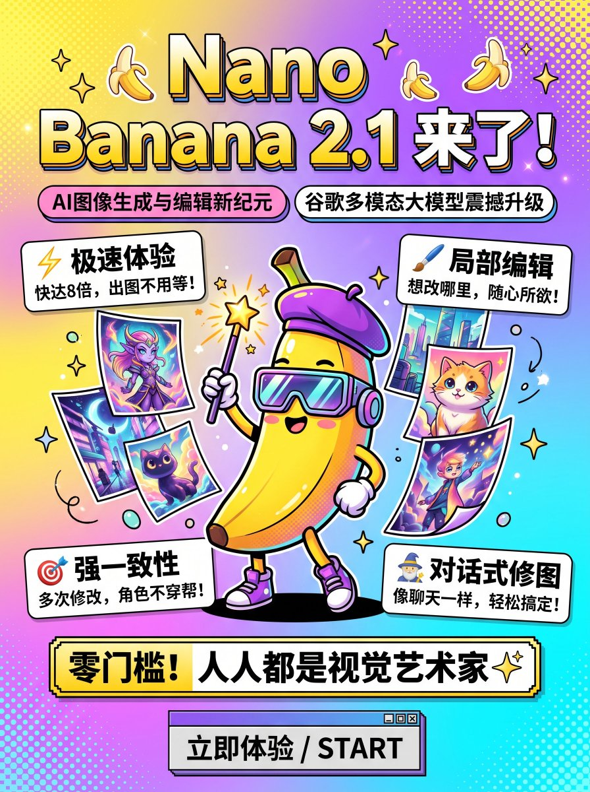

> 在线阅读（GitHub Pages）：https://maynor996.github.io/nano-banana-2-1/

# Nano Banana 2.1 来了！21 个真实案例 + 公开提示词，这份 Awesome 合集请收好



*图注：合集精选案例拼贴（人像 / 棋盘对比 / 小红书海报 / 深夜食堂 2.0 vs 2.1）。在线画廊：https://xianyu110.github.io/awesome-nano-banana-2.1/*

---

最近 Google 的图像模型 **Nano Banana 2.1**（API：`gemini-nano-banana-2.1`，Google Flow 里有时显示代号 **beluga**）在社区里热度很高：速度快、提示跟随更稳，中文与排版场景也更敢试了。

但问题也很现实——X 上刷到的 demo 往往「好看却不好抄」：封面图有了，提示词却藏着；或者模型名写得含糊，和 Pro / 旧版混在一起。

于是有了这份开源合集：

**[awesome-nano-banana-2.1](https://github.com/xianyu110/awesome-nano-banana-2.1)**  
由 [@xianyu110](https://github.com/xianyu110) 整理，**只收录「封面图 + 作者公开提示词」齐全**的案例，去重后目前 **21 条**，并配有可筛选、可搜索、可一键复制提示词的在线画廊。

如果你正在测 Nano Banana 2.1，或想快速找到可复现的中文海报 / 人像 / 对比评测灵感，这篇可以直接当导航用。

---

## 一、Nano Banana 2.1 是什么？为什么要单独做 Awesome？

社区语境里，**Nano Banana 2.1** 一般指 Google Gemini 的一档图像模型：

| 项目 | 说明 |
|---|---|
| 产品名 | Nano Banana 2.1 |
| API ID | `gemini-nano-banana-2.1`（Google AI Studio / Gemini API） |
| 其他入口 | Google Flow、Gemini App 等；Flow 内代号有时为 **beluga** |
| 社区印象 | 偏 Flash 路线、生成快；提示跟随与文字表现有改进；常被拿来和 GPT Image 2.5 / 同系列 Lite·2.0 做同 prompt 对比 |

单独做 Awesome 的原因很简单：

1. **可复现**：没有公开 prompt 的「炫图」很难学习；  
2. **可核对**：帖内需明确写明 Nano Banana 2.1 / `gemini-nano-banana-2.1` / Flow beluga，避免和 [awesome-nanobananapro-prompts](https://github.com/xianyu110/awesome-nanobananapro-prompts)（Pro）混淆；  
3. **可浏览**：GitHub README 适合收藏，Pages 画廊适合「边看图边复制」。

数据快照时间：**2026-10-07 14:29（UTC+8）**。互动数为整理时快照；作品与提示词版权归原作者。

---

## 二、怎么用？两条入口就够

### 1）GitHub 仓库（适合 Star / Fork / 提 PR）

🔗 **仓库**：https://github.com/xianyu110/awesome-nano-banana-2.1  

README 按 5 个分类列出全部案例，并附预览图、原帖链接与提示词入口。

### 2）在线画廊（适合日常查阅与复制提示词）

🌐 **画廊**：https://xianyu110.github.io/awesome-nano-banana-2.1/  

支持：

- 按分类筛选（对比评测 / 产品商业 / 人像角色 / 文字海报 / 其他）  
- 关键词搜索  
- **一键复制公开提示词**  
- 跳转原作者 X 帖子核对上下文  

建议工作流：画廊里挑喜欢的图 → 复制 prompt → 在 Gemini / Flow / API 里复现或改写 → 把你的「图 + 公开提示词」贡献回去。

---

## 三、先看 5 个有代表性的案例

下面从 21 条里挑了跨品类的 5 个样例（人像、对比、中文广告字、小红书海报、历史书法场景）。**提示词均为作者公开原文摘录，版权归原作者；请尊重署名并附原帖链接。**

---

### 案例 1｜明暗对照法电影感特写人像

- **分类**：人像 / 角色  
- **作者**：[@rovvmut_](https://x.com/rovvmut_)  
- **原帖**：https://x.com/rovvmut_/status/2107691827323392159  
- **画廊**：https://xianyu110.github.io/awesome-nano-banana-2.1/#2107691827323392159  
- **简介**：左侧强光、右侧深影、黑背景，35mm 胶片颗粒与浅景深，强调角色一致性——很适合当作「电影感人像」模板起步。


**提示词摘录：**

```text
A hyper-realistic, 8K resolution cinematic close-up portrait of the person in the uploaded image. The image features dramatic chiaroscuro lighting, heavily illuminating the left side of his face while casting deep, moody shadows on the right against a solid black background. He has an intense, direct gaze, dark brown eyes with square catchlights, and textured, wet-styled hair. ...
```

（完整提示词请到画廊或原帖一键复制。）

---

### 案例 2｜棋盘暮影成城市天际线：2 Lite vs 2.1

- **分类**：对比评测  
- **作者**：[@EmilioSchwaiger](https://x.com/EmilioSchwaiger)  
- **原帖**：https://x.com/EmilioSchwaiger/status/2107699973869494754  
- **画廊**：https://xianyu110.github.io/awesome-nano-banana-2.1/#2107699973869494754  
- **简介**：同 prompt 左右对比 Nano Banana 2 Lite 与 2.1——棋子在暮光下的长影，拼出城市天际线轮廓。想感受版本差异，这类「同题对比」最直观。


**提示词（全文较短，可直接试）：**

```text
A top-down photo of a chessboard mid-game, the long shadows of the pieces cast by low evening sun form the silhouette of a city skyline across the board
```

---

### 案例 3｜中文广告字：2.0 vs 2.1（深夜食堂等）

- **分类**：文字设计 / 海报  
- **作者**：[@sui1723](https://x.com/sui1723)  
- **原帖**：https://x.com/sui1723/status/2107677832621314458  
- **画廊**：https://xianyu110.github.io/awesome-nano-banana-2.1/#2107677832621314458  
- **简介**：「深夜食堂」「周末限定 买一送一」这类短促广告文案，是测 CJK 文字与构图光影的好探针。作者观察：文字差异未必夸张，变的是整体构图与光影气质。



**提示词：**

```text
深夜食堂
周末限定 买一送一
```

---

### 案例 4｜小红书海报：联网搜索 + 3:4

- **分类**：文字设计 / 海报  
- **作者**：[@nicekate8888](https://x.com/nicekate8888)  
- **原帖**：https://x.com/nicekate8888/status/2107507607183478923  
- **画廊**：https://xianyu110.github.io/awesome-nano-banana-2.1/#2107507607183478923  
- **简介**：一句中文需求直接生成 **3:4 小红书海报**，并带联网搜索信息——对做运营、自媒体排版的同学非常友好。



**提示词：**

```text
Nano Banana 2.1 已推出，请搜索信息，并生成适合小红书的海报，3:4
```

---

### 案例 5｜王羲之正在写传世名作

- **分类**：文字设计 / 海报  
- **作者**：[@wshuyi](https://x.com/wshuyi)  
- **原帖**：https://x.com/wshuyi/status/2107678239158309266  
- **画廊**：https://xianyu110.github.io/awesome-nano-banana-2.1/#2107678239158309266  
- **简介**：极短的中文历史场景提示，同时考验人物、场景与书法文字。短 prompt 也能出系列结果，适合观察模型的「脑补」能力。


**提示词：**

```text
王羲之正在写他的传世名作
```

---

> 其余 16 个案例（UGC 产品实拍、iPhone 闪光抓拍、双参考人物融合、游戏 UI 对比、叶片缝隙嵌字等）请直接打开画廊浏览：  
> https://xianyu110.github.io/awesome-nano-banana-2.1/

---

## 四、收录标准（为什么这本合集「能抄」）

合集的 curation 规则很硬，也正是它的价值所在：

1. **只收创作者本人发布的原帖**；明显搬运不收。  
2. 帖子里**明确写了 Nano Banana 2.1**（或 `gemini-nano-banana-2.1` / Flow `beluga`）。  
3. **必须同时有封面预览图 + 非空公开提示词**（正文或作者回复中可查）；**缺一不收**。  
4. 封面优先使用 `pbs.twimg.com` 等 X 公开媒体 URL。  
5. 模型归属以各作者自述为准；作品与提示词版权归原作者。

一句话：**没有公开 prompt 的炫图，进不了这份列表。**

当前分类结构：

| 分类 | 说明 |
|---|---|
| ⚖️ 对比评测 | 同 prompt 跨版本 / 跨模型 |
| 🛍️ 产品 / 商业 | UGC、电商实拍风等 |
| 👤 人像 / 角色 | 电影感、胶片、iPhone 直出等 |
| ✍️ 文字设计 / 海报 | 中文广告字、小红书、书法场景等 |
| ✨ 其他 | 首测、趣味、发布向 |

---

## 五、欢迎 Star，也欢迎 PR

如果你：

- 用 Nano Banana 2.1 做出了满意的作品，并且 **愿意公开提示词**；  
- 发现了优质原帖（图 + prompt 齐全、模型标注清楚）；  
- 想补充中文案例、修正链接或改进画廊体验；  

欢迎给仓库点个 **Star**，并直接提 **Issue / Pull Request**：

⭐ https://github.com/xianyu110/awesome-nano-banana-2.1  

贡献前请确认：

- 帖内写明 Nano Banana 2.1 / `gemini-nano-banana-2.1` / beluga；  
- 有可引用的封面图 URL；  
- 有可复制的公开提示词原文；  
- 注明原作者与原帖链接。

---

## 六、快速链接汇总

| 资源 | 链接 |
|---|---|
| GitHub 仓库 | https://github.com/xianyu110/awesome-nano-banana-2.1 |
| 在线画廊 | https://xianyu110.github.io/awesome-nano-banana-2.1/ |
| 维护者 | [@xianyu110](https://github.com/xianyu110) |
| 英文 README | https://github.com/xianyu110/awesome-nano-banana-2.1/blob/main/README.en.md |

---

**写在最后：**  
模型迭代很快，真正能沉淀下来的，往往是「可复现的案例库」。Awesome Nano Banana 2.1 把社区里已经公开的图与提示词收拢成可检索的画廊——你负责创造，仓库负责帮你被更多人看见。

去画廊逛一圈，复制一条 prompt，今晚就开测吧 🍌